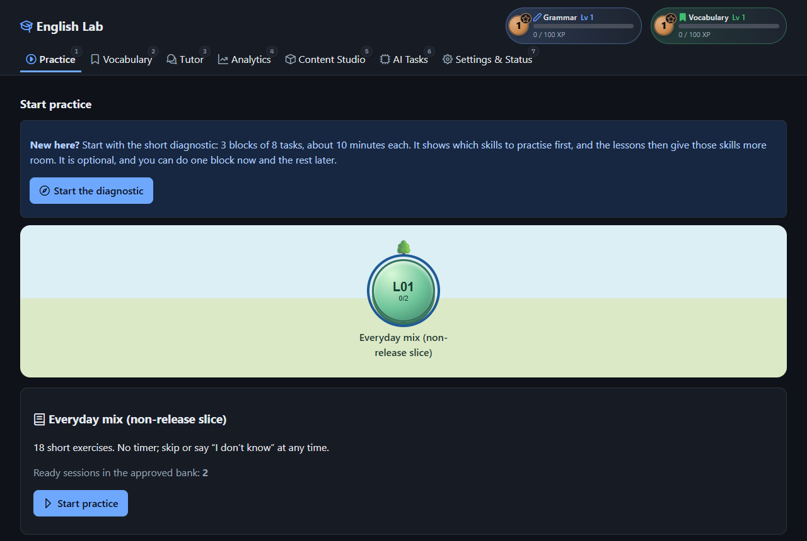
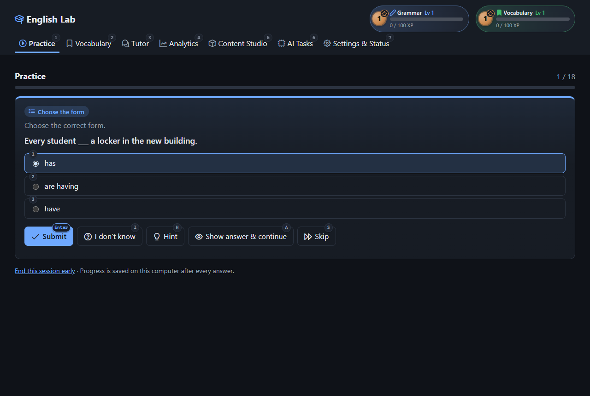
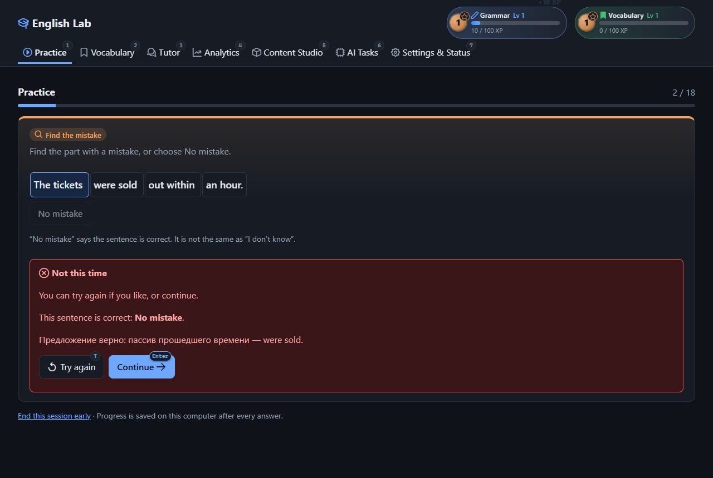
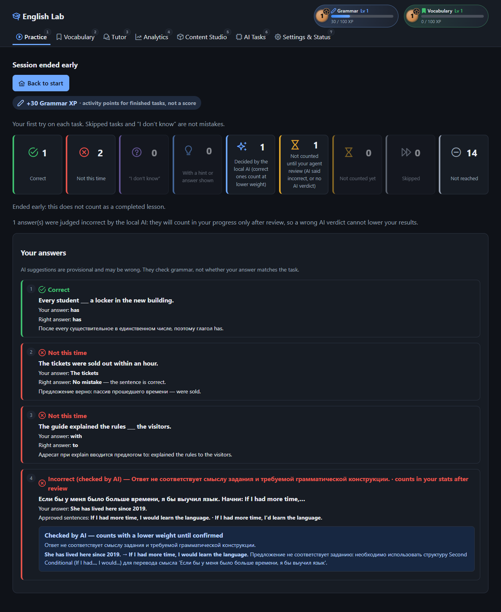
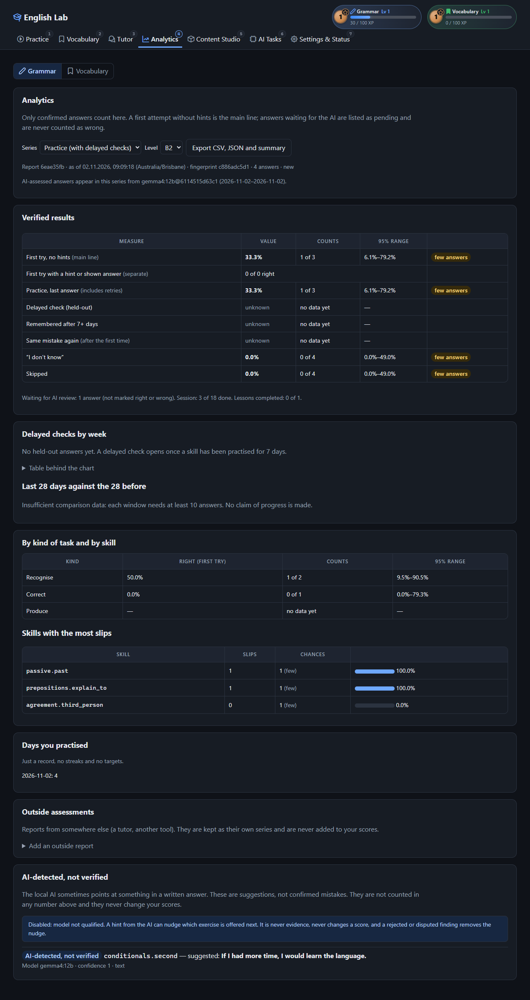

# Adaptive English Lab

A local-first, AI-assisted English practice application that aims to improve grammar accuracy, short written answers and active language production through adaptive exercises.

> **Status: Work in Progress — Active Development**
>
> This repository is published early so that development is visible. A first usable version exists: ten lessons, an optional diagnostic, practice with feedback, voice input, analytics, vocabulary and a tutor all run locally. It has **not** had an independent human review yet, and the local models are not qualified to grade answers on their own. See [Development status](#development-status) for an honest breakdown.

## Why this project exists

Most grammar courses push every learner through the same fixed curriculum. Adaptive English Lab starts from a different question: *which constructions do I personally keep getting wrong, and can I produce them correctly on my own?*

The design principles are:

- **Individual weaknesses first.** Practice is allocated from recurring mistakes, not from a fixed lesson order.
- **Production over recognition.** Exercises move from choosing a form towards building short sentences yourself. Mastery is not raised by viewing answers, using hints or generating content.
- **No repeated sentences.** The same sentence is not shown again as if it were a new exercise; weak constructions are reinforced with new sentences.
- **Honest numbers.** Statistics are computed by deterministic code from raw, immutable attempt records. A language model is never the source of truth for progress.
- **AI output is a draft.** Generated content and AI feedback carry explicit statuses (`draft`, `pending_review`, `approved`, …) and are never auto-approved.
- **Personal and local.** One user, one machine, no app account or telemetry; optional Groq speech recognition sends audio to Groq.

The app interface is in English; harder explanations and translations are intended to be in Russian, because the project was built for a Russian-speaking learner. Learning material follows Australian English norms.

## Screenshots

Real screenshots of the running app (dark theme), taken on the small non-release demo profile (`npm run slice`) with fictional, hand-written sentences. No personal data is shown.

| Start page | Exercise | Feedback with an optional retry |
|---|---|---|
|  |  |  |

| Session summary | Analytics |
|---|---|
|  |  |

## Key features

Legend: **Working** = implemented and covered by automated tests · **Partial** = backend exists, no complete user-facing flow · **Planned** = specified, not implemented.

| Area | Status | Notes |
|---|---|---|
| Local backend and SQLite storage | Working | Fastify server bound to `127.0.0.1`; versioned SQL migrations, WAL mode, verified backups, CLI restore, single-instance lock. |
| Immutable attempt history | Working | Raw attempts and every assessment revision are kept; correcting a grade never deletes history. |
| Exercise formats and grading | Working | Six formats validated against a schema; closed answers and approved short-answer variants are graded by code. Other written answers stay "pending" — never marked wrong by code. |
| Adaptive sessions with no-repeat | Working | Sessions (18 exercises by default) are assembled from the approved bank; a sentence is never shown again as a new exercise. |
| Practice interface | Working | All formats, "I don't know", skip, hint, show answer, optional retry, Russian explanations, session summary, lesson choice. |
| Settings | Working | Exercises per session (5–30), weak-skill share, voice tasks and sentence difficulty (A2–C2; default B1–C1). Each change is a new revision; past sessions are unaffected. |
| First ten lessons | Working | 306 exercises: 10 lessons (three with reading passages), a diagnostic and held-out checks. Written by one AI model and reviewed item by item by another. Loaded with `npm run first10:seed`. |
| Diagnostics and delayed checks | Working | Optional three-block starting diagnostic without hints; skills you miss there get more room in the lessons. Held-out checks on new sentences at least 7 days after practice. |
| Speech-to-text | Working | Local `faster-whisper` or optional Groq transcription; the app keeps audio in memory and the transcript is editable before submission. Tested with synthetic speech only. |
| Analytics and export | Working | Reports computed by code from raw attempts (first-attempt accuracy, Wilson intervals, series kept apart), CSV/JSON export, external assessment import. A separate Vocabulary view shows recognition, recall and collocation accuracy with sample sizes, XP by day and words that need another look. |
| Vocabulary | Working | Save a word from any exercise; the local model drafts a translation and a CEFR level, your own edits are never overwritten. No flashcards. |
| Vocabulary Practice | Working | Optional short sessions (5–10 tasks, default 8) with your saved words in new sentences: word in context, recall from a clue, collocations. Graded by code; kept apart from grammar Mastery. |
| Keyboard | Working | Enter answers and continues, 1–9 pick an option, I / H / A / S act, hold M to speak (release to transcribe), Alt+1…7 switch tabs. The key is shown on a small badge on each button. |
| Levels and XP | Working | Two independent tracks in the header, Grammar and Vocabulary: 10 XP per finished task, a level every 100 XP, tier badges. Activity, not a grade. |
| Tutor | Working | Explains an answered task (approved rule first, AI drafts labelled as drafts); "Copy Agent Task" for an external coding agent. |
| Content Studio | Working, reviewed | Grammar and dictionary-based vocabulary batches (default 50), stock warnings, and one copied agent task to review, repair and publish. Every final revision needs an individual review; corrections need an independent reviewer. |
| GPU-aware task scheduler | Working | One GPU dispatcher; speech has top priority and pauses background AI work. |
| Local AI answer analysis (Ollama) | Partial | Versioned prompts and schema-validated output. **Models are not qualified**: AI findings stay tentative and never confirm a grade or change Mastery. |

## How it works

1. **Initial assessment** — an optional mixed diagnosis (three short blocks, no hints, answers shown after each block).
2. **Find weak skills** — raw attempts are mapped to a grammar-skill taxonomy and scored by a deterministic Mastery engine.
3. **Practise with varied exercises** — choose the form, find the error, choose the missing fragment, read in context, guided short answer, Russian-to-English short answer; typed or spoken.
4. **Get feedback** — immediate feedback with an optional retry; "I don't know" and skipping are never penalised as mistakes. Written answers that are not an approved variant stay "pending" and get a tentative local-AI review in the background.
5. **Reinforce with new sentences** — weak constructions are re-allocated, but never as repeated sentences.
6. **Track improvement** — analytics from the raw event history, with delayed checks on unseen sentences.
7. **Generate more material with local AI** — drafts that a reviewer approves item by item before use.

## Technology stack

| Layer | Technology | Role |
|---|---|---|
| Language | TypeScript (Node.js 22) | Shared across backend, frontend and contracts. |
| Backend | Fastify 5, Zod, Ajv | Local HTTP API on `127.0.0.1`, validation, job queue and scheduler. |
| Database | SQLite via `better-sqlite3` | Raw attempts, exercise revisions, analytics versions, AI annotations, jobs. |
| Frontend | React 19, Vite | Single-page UI served by the backend. |
| Local LLM | [Ollama](https://ollama.com) with `gemma4:12b` | The single local model: tentative answer checks, drafts, vocabulary cards, tutor drafts. |
| Speech recognition | Groq `whisper-large-v3` (when `GROQ_API_KEY` is set), else `faster-whisper` (Python 3.11, CUDA) | Setting `GROQ_API_KEY` in the environment or the git-ignored `.env` sends audio to Groq; otherwise the local worker is used. |
| Tests | Vitest, Playwright (core) | Unit, integration and end-to-end tests. |

The repository is an npm workspace: `apps/server`, `apps/web`, `packages/contracts` (shared types), `packages/learning` (Mastery, priorities, selection), plus `migrations/`, `content/`, `scripts/` and `tests/`.

## Getting started

The project targets **Windows 11** (the start scripts use Windows tooling) and has been developed on an NVIDIA RTX 5060 Ti with 16 GB VRAM. The steps below were run on that machine with Node 22.17.1 and npm 11.

### Prerequisites

| Requirement | Needed for | Mandatory |
|---|---|---|
| Node.js `>=22.17.0 <23` and npm | Everything | Yes |
| Ollama with `gemma4:12b` | Local AI analysis, vocabulary drafts, tutor | No — practice works without it |
| NVIDIA GPU with ~16 GB VRAM | Local models | No |
| Python 3.11 with `faster-whisper` | Speech input | No — you can always type |

### Install and run

```powershell
git clone https://github.com/rever273/adaptive-english-lab.git
cd adaptive-english-lab
npm install
npm run build
npm run first10:seed
npm start
```

`npm run first10:seed` loads the first ten lessons, the diagnostic and the delayed checks into your profile (run it once, while the app is stopped; running it again adds nothing twice). `npm start` starts the server in the background and opens <http://127.0.0.1:4318/>; `npm stop` stops it. If you prefer to keep the server in a terminal window, use `npm run lab` instead and stop it with Ctrl+C. Closing the browser does not stop anything.

Your data lives in `var/` inside the project (git-ignored). To keep the database file itself on a faster drive, create `englishlab.local.json` in the project folder with `{ "dbDir": "C:\\Databases\\EnglishLab" }` (or set `ENGLISHLAB_DB_DIR`); backups and logs stay in `var/`.

`npm run slice` starts a separate demo profile in `var/slice` with a small non-release bank of 45 exercises; stop it with `npm run slice:stop`.

### Backups and restore

- A verified backup is made automatically once a day and before every schema migration; `npm run backup` makes one on demand.
- `npm run restore -- --list` lists backups; `npm run restore -- --backup <id> --dry-run` shows what would be rolled back.
- To restore: `npm stop`, then `npm run restore -- --backup <id> --confirm <id>`, then `npm start`. The current database is kept as a safety backup first, and any failure puts it back unchanged.
- Backups contain your answers: do not sync them to a cloud folder.

### Working with a coding agent

The Practice page has a **Work with your coding agent** card with two buttons. Each copies a complete task for an agent such as Claude Code in VS Code:

- **Review my results** — the agent reads your recent sessions with read-only exports, checks that every exercise and every grade was right, fixes wrong exercises as new revisions and reports your weak and recurring skills.
- **Create new lessons** — the agent uses a computed skill-priority report to prepare lesson structures without writing exercises. Change the number at the end of the copied task if needed. The agent validates and publishes the structures; Content Studio separately supplies individually reviewed exercises. A lesson can appear on the path before enough exercises are available to start it.

For routine replenishment, open **Content Studio**, choose **Grammar exercises** or **Vocabulary exercises**, and press **Start batch** (50 by default). The local model writes drafts through the shared GPU queue. When generation finishes, press **Copy** under **Task for the reviewing agent** and give the task to your coding agent. It reviews every item, corrects suitable drafts, obtains independent review of final content and publishes accepted exercises. The batch and coverage update automatically; there is no JSON to paste back or manual publishing step. Stock warnings count unused, approved, released exercises and appear before the supply runs out.

The reusable instructions are in `content/agent-workflows/grammar.md` and `vocabulary.md`. `npm run content:agent -- prepare <batch-id>` prepares a compact local packet; `check` validates final candidates and supplies relevant duplicate/held-out comparisons without changing the database; `finalize` applies the complete reviewed result through the running local service in one transaction. Work files stay under git-ignored `var/agent-batches/`. An identical retry returns the saved result, and corrected content preserves the original revision and attempt history. Legacy content packs remain supported.

The agent never edits the database directly; all changes go through the same validation, no-repeat check and per-item review as the built-in lessons.

### Configuration

No `.env` file is required. Optional environment variables:

| Variable | Default | Purpose |
|---|---|---|
| `ENGLISHLAB_PORT` | `4318` | Port on `127.0.0.1` (1024–65535). |
| `ENGLISHLAB_DATA_ROOT` | `<project>/var` | Data directory; must be inside the project or `%LOCALAPPDATA%`. |
| `ENGLISHLAB_DB_DIR` | `<data root>/db` | Folder for the database file only (absolute local path); overrides `dbDir` in `englishlab.local.json`. |
| `ENGLISHLAB_DEV_ORIGIN` | unset | Extra allowed origin when running the Vite dev server. |
| `ENGLISHLAB_NO_OPEN` | unset | Set to `1` to skip opening the browser. |

The server never listens on anything other than loopback.

### Ollama (optional)

If Ollama is running locally, the server detects it and reports model readiness on the **Status** page and at `/api/v1/capabilities`. The configured model tag is `gemma4:12b`; the app does not download models. A GPU check can be run with `npm run verify:gpu`; it uses a scratch database.

### Tests

```powershell
npm run typecheck
npm run test:unit          # unit tests
npm run test:integration   # integration tests (about 20 minutes)
npm run test:e2e           # browser tests (need a build and Microsoft Edge)
npm run test:python        # speech worker tests
npm run first10:check      # structure and duplicate audit of the lesson bank
```

Run results are kept in the project's evidence notes, which are not part of this repository.

## Privacy and local-first design

- The backend accepts connections from the local machine only, and the data directory is restricted to the project or the user's local application-data folder.
- Attempts, answers, exercise history and statistics are stored in a local SQLite database under `var/`, which is excluded from version control.
- The app has no login, payment flow or telemetry. Optional Groq speech recognition requires a Groq account and sends audio to that service.
- The AI components are local (Ollama). No request is sent to an external AI service.
- Speech recognition runs locally by default. If a Groq API key is configured, audio is sent to Groq for transcription. The app does not write audio to disk; you can edit the transcript before submitting your answer. Groq retention is governed by its data controls.
- The database, backups and logs are git-ignored. Please keep it that way if you fork the project.

This repository contains **no personal learning data**. If you run the app, create your own learning profile through your own practice and assessments; do not rely on any assessment of the original author. All examples in the repository and screenshots use fictional or hand-written sample sentences.

## Development status

| Stage | Scope | State |
|---|---|---|
| Architecture and specifications | Product, data, AI and UX specifications | Done |
| Environment spikes | Feasibility of local models, GPU and STT | Done, with limitations |
| Foundation | Project skeleton, migrations, backups | Done |
| Immutable events, Mastery, content validation | Raw attempts, scoring, six exercise formats | Implemented; independent strong review pending |
| Session allocator and practice slice | No-repeat adaptive sessions, early UI | Implemented; author's comfort verdict pending |
| GPU queue and AI adapters | Persistent scheduler, local model adapter, benchmark | Implemented; models not qualified, strong review pending |
| Content Studio, STT, full practice UI, settings | Tasks 010–012 | Implemented |
| Diagnostics, analytics UI, vocabulary, tutor | Tasks 013–016 | Implemented |
| First ten lessons, release hardening | Tasks 017–018 | Implemented; author's acceptance pending |

Known limitations right now: lessons are written and reviewed by AI models, not by a teacher; the local models are not qualified, so AI feedback on written answers stays tentative; voice input was tested with synthetic speech only; and restore is a command-line operation.

## Roadmap

The plan is organised as small, independently verifiable tasks. No dates are promised.

1. **More lessons** — created by a coding agent from your own results, with per-item review by a second model.
2. **Model qualification** — a gold set adjudicated independently, so AI feedback can be trusted for specific error types.
3. **Remaining settings** — difficulty, explanation depth and vocabulary share are stored but not used by the allocator yet.


## Contributing

Feedback, bug reports and ideas are welcome — please open an issue. Because the project is moving quickly, it is best to open an issue before starting a larger pull request. Small fixes, documentation improvements and corrections to English example sentences are especially useful.

## Licence

Released under the [PolyForm Noncommercial License 1.0.0](LICENSE). In plain terms: you may use, study and modify the code for personal use, learning, research and other non-commercial purposes. Commercial use requires separate permission from the author. This is a source-available licence, not an OSI-approved open-source one.

The first commit of this repository was briefly published under the MIT licence; the PolyForm Noncommercial licence replaces it for all later versions.

### Review and benchmark materials

Reviewers can use [the content and AI review guidelines](content/review-guidelines.md). Internal development documents and benchmark cases are not included. To run `npm run benchmark:ai`, provide your own reviewed manifest with `--manifest <file>`; the same option is available for `scripts/nimble-tune.mjs` and `scripts/benchmark-review-packet.mjs`. Benchmark labels still require independent review.
